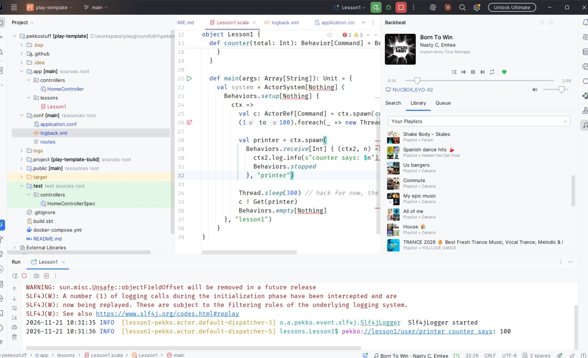
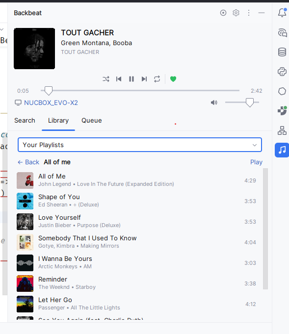
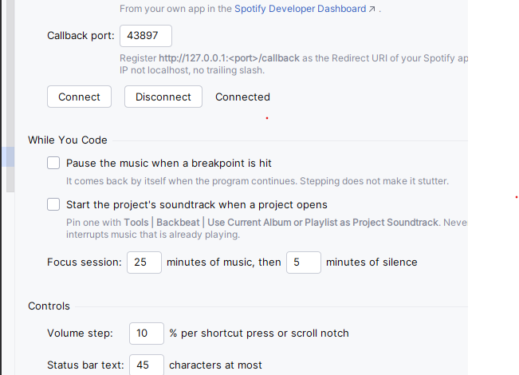

# Backbeat

**Control Spotify without leaving your JetBrains IDE.**

[](https://plugins.jetbrains.com/plugin/36354)
[](https://plugins.jetbrains.com/plugin/36354)
[](https://plugins.jetbrains.com/plugin/36354)
[](https://github.com/zakariahere/backbeat-intellij-plugin/actions/workflows/build.yml)

**[Get Backbeat from the JetBrains Marketplace](https://plugins.jetbrains.com/plugin/36354)**, or in your IDE: **Settings \| Plugins \| Marketplace**, search for **Backbeat**.

Backbeat is a remote control for Spotify, built for people who live in the editor. The music keeps
playing in the Spotify app on your computer, phone or speaker; you search, skip and queue from
IntelliJ IDEA (or any other JetBrains IDE, 2025.3 and newer).

> [!IMPORTANT]
> **Keep the Spotify desktop app open next to your IDE.** Backbeat is a remote control, not a
> player: it tells Spotify what to do, and Spotify makes the sound. If the Spotify app is closed,
> there is nothing to control and you will see "Spotify is not running". Minimised or in the
> tray is fine; it just has to be running and signed in to the same account.

> Codename `spotidea`. Independent open-source project, not affiliated with or endorsed by Spotify.



| Browse a playlist | Settings |
|---|---|
|  |  |

## What you get

| | |
|---|---|
| **Player tool window** | Cover art, play/pause, skip, seek, shuffle, repeat, like, volume, and a device picker |
| **Search Everywhere tab** | Press <kbd>Shift</kbd> twice, open the **Spotify** tab, type, <kbd>Enter</kbd>. <kbd>Shift</kbd>+<kbd>Enter</kbd> queues instead |
| **Library and queue** | Your playlists, Liked Songs, recently played, and what is up next. Double-click an album or playlist to browse its tracks |
| **Status bar** | Current song. Click for a mini player, middle-click to play/pause, scroll to change the volume |
| **Shortcuts** | Every control is an IDE action you can bind in **Settings \| Keymap** |

And three things only an IDE plugin can do:

- **Pause on breakpoint.** The music stops when a breakpoint is hit and comes back when the program
  continues. Stepping does not make it stutter. (Off by default.)
- **Project soundtrack.** Pin an album or playlist to a project: right-click it, or use
  **Tools \| Backbeat \| Use Current Album or Playlist as Project Soundtrack**. Optionally start it
  when the project opens. Stored per user, so it is not shared through version control.
- **Focus sessions.** A Pomodoro timer wired to the music: it plays while you focus (25 minutes by
  default) and goes quiet for the break. The countdown shows in the status bar.

### Default shortcuts

| Action | Windows / Linux | macOS |
|---|---|---|
| Play / Pause | <kbd>Ctrl</kbd>+<kbd>Alt</kbd>+<kbd>Shift</kbd>+<kbd>P</kbd> | <kbd>⌃</kbd><kbd>⌥</kbd><kbd>⇧</kbd><kbd>P</kbd> |
| Next song | <kbd>Ctrl</kbd>+<kbd>Alt</kbd>+<kbd>Shift</kbd>+<kbd>.</kbd> | <kbd>⌃</kbd><kbd>⌥</kbd><kbd>⇧</kbd><kbd>.</kbd> |
| Previous song | <kbd>Ctrl</kbd>+<kbd>Alt</kbd>+<kbd>Shift</kbd>+<kbd>,</kbd> | <kbd>⌃</kbd><kbd>⌥</kbd><kbd>⇧</kbd><kbd>,</kbd> |

Like, volume, search, copy link and the rest ship unbound so they cannot clash with your keymap.

## Setup (about a minute, once)

Spotify limits every third-party app in development mode to five users, so a shared Client ID
cannot serve a community plugin. You use your own; it is free.

Before you start: install the [Spotify desktop app](https://www.spotify.com/download), sign in, and
leave it running.

1. Open the [Spotify Developer Dashboard](https://developer.spotify.com/dashboard) and choose **Create app**.
2. Set the **Redirect URI** to `http://127.0.0.1:43897/callback`.
3. Tick **Web API** and save.
4. Copy the app's **Client ID** into the Backbeat tool window and press **Connect to Spotify**.

Your browser opens for the login and you are done. The tool window shows the same steps.

### Good to know

- **Spotify Premium is required.** Spotify only lets Premium accounts be controlled from other
  apps, and it also requires the owner of a development-mode app (that is you, with your own
  Client ID) to have Premium.
- **The Spotify desktop app must be open** (see the note at the top). Backbeat sends commands; it
  does not produce sound. The Spotify web player needs DRM that the IDE's embedded browser does not
  have, so in-IDE audio is not possible. Tip: once the desktop app is running, the device picker
  also lets you send the music to your phone or a speaker.
- **"Spotify is not running" although it is?** Open the Spotify desktop app and press play there once.
  Spotify forgets idle devices after a while; one press wakes it up, and Backbeat takes over again.
- If port 43897 is taken, change it in **Settings \| Tools \| Backbeat** and in your Spotify app.

### Privacy

Backbeat talks only to `accounts.spotify.com` and `api.spotify.com`. Login uses OAuth with PKCE, so
there is no client secret and your password never reaches the IDE. The refresh token is stored in
the IDE password safe (the OS keychain where available). No analytics, no telemetry.

## Building from source

Requires JDK 21. Everything else is downloaded by the Gradle wrapper.

```
./gradlew runIde          # start a sandbox IDE with the plugin installed
./gradlew test            # unit tests plus headless UI smoke tests (PNG previews land in build/ui-preview)
./gradlew buildPlugin     # build/distributions/spotidea-<version>.zip
./gradlew verifyPlugin    # JetBrains Plugin Verifier
```

Install a built zip with **Settings \| Plugins \| ⚙ \| Install Plugin from Disk…**

Two optional properties save large downloads when you already have an IDE installed:

```
./gradlew buildPlugin  -PlocalIdePath="<IDE install dir>"     # compile against it
./gradlew verifyPlugin -PverifyIdePath="<IDE install dir>"    # verify against it
```

### How it is put together

```
dev.spotidea
├─ auth/       PKCE login, token refresh, password-safe storage
├─ api/        Spotify Web API client and tolerant JSON parsing
├─ player/     PlayerService: the one poller and command runner every UI listens to
├─ ui/         tool window, Now Playing panel, media browser
├─ statusbar/  status bar widget and mini player
├─ search/     Search Everywhere tab
├─ actions/    keyboard-bindable actions
└─ dev/        breakpoint pause, project soundtrack, focus sessions
```

One service polls Spotify (every 3 s while playing, slower when idle or when the IDE is in the
background) and publishes snapshots on the message bus. Every view is a thin listener, so three
visible UIs cost the same API quota as one.

### Releasing

Releases are cut by pushing a tag. The [Release workflow](.github/workflows/release.yml) tests, builds,
publishes to the Marketplace stable channel and attaches the zip to a GitHub Release.

1. Bump `pluginVersion` in `gradle.properties` and add a `change-notes` entry in `plugin.xml`.
2. Commit, then tag with the same version and push:

   ```
   git tag v0.1.1
   git push origin main v0.1.1
   ```

The workflow refuses to run if the tag and `pluginVersion` differ. It needs one repository secret,
`PUBLISH_TOKEN`, created under **My Tokens** on the Marketplace. Signing is optional: add
`CERTIFICATE_CHAIN`, `PRIVATE_KEY` and `PRIVATE_KEY_PASSWORD` as secrets to enable it.

Every push and pull request also runs the [Build workflow](.github/workflows/build.yml), which uploads
the plugin zip and the UI preview images as artifacts.

## License

[MIT](LICENSE)
